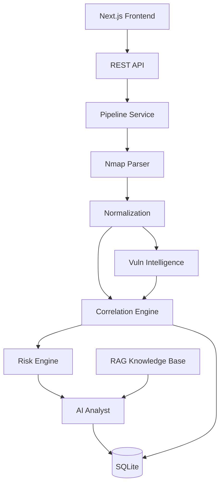

# Architecture

Sentinel-AI is a modular monolith: a FastAPI backend and a Next.js frontend. No microservices, no custom databases.

## Layers

## Components

- **Ingestion** (`app/parsers/nmap.py`): defusedxml-based parsing of Nmap XML into `SecurityEvidence` with typed assets, services (port/protocol/product/version/state), OS info, and timestamps. XXE and malformed-input safe.
- **Normalization** (`app/services/normalization.py`): deduplicates assets by IP and merges services/metadata.
- **Correlation engine** (`app/services/correlation.py`): rule-based; each rule receives an asset and its per-service vulnerabilities and emits findings. New rules can be appended to `RULES` without touching the engine.
- **Risk engine** (`app/services/risk.py`): deterministic scoring.

  `risk_score = base(severity) × confidence_factor × exposure_factor`, clamped to [0, 100].

  | Band | Score |
  | --- | --- |
  | INFO | 0–19 |
  | LOW | 20–39 |
  | MEDIUM | 40–59 |
  | HIGH | 60–79 |
  | CRITICAL | 80–100 |

  Base: INFO 10, LOW 25, MEDIUM 45, HIGH 70, CRITICAL 90. Confidence: confirmed 1.0, probable 0.85, possible 0.6, unknown 0.5. Exposure: public 1.0, unknown 0.8, internal 0.7. The LLM never sets the final score.
- **Vulnerability intelligence** (`app/services/vulns/`): `local.py` curated CVE dataset matched on product+version; `nvd.py` live NVD keyword lookup (confidence `possible`). Local matches win on dedupe. Failures degrade to local-only.
- **AI analyst** (`app/services/ai/analyst.py`): builds a structured JSON payload, retrieves RAG context, calls OpenAI → Ollama → deterministic local fallback, and validates output against the `AIAnalysis` pydantic schema. Invalid JSON, timeouts, or provider errors fall back gracefully.
- **RAG** (`app/services/ai/rag.py`): chunking + lightweight token-overlap retrieval over bundled docs in `app/services/ai/knowledge/`. Chosen over a vector DB to avoid unnecessary infrastructure.
- **Persistence** (`app/db`): SQLite via SQLAlchemy 2.0 storing scan evidence, findings, and AI analysis as JSON; reports as markdown. The AI analysis is stored **once per scan** (`analysis_json`) and attached to a finding only when serving `GET /api/v1/findings/{id}`, rather than being duplicated into every finding record. Analyst triage lives in its own `finding_triage` table, keyed by a content fingerprint because finding UUIDs are regenerated on every analysis run.
- **Pipeline** (`app/services/pipeline.py`): orchestrates ingest → analyze → store → report. Also owns the shared list-view shape of a scan (`scan_summary`), so the scans, assets and scan-detail endpoints cannot drift apart.
- **Findings assembly** (`app/services/findings.py`): walks every scan's stored findings and overlays the analyst triage rows. Findings live inside scan rows rather than in their own table, so "all findings" and "this host's findings" are the same walk; keeping it in one place stops the findings and assets routes from each re-implementing the overlay.

## Design Decisions

- Deterministic security logic; AI only explains/prioritizes/recommends.
- Structured LLM output validated with pydantic; never trust raw completions.
- NVD/LLM failures never break the analysis pipeline.
- No auth in MVP; CORS is restricted to origins listed in `SENTINEL_CORS_ORIGINS` rather than open to all.
- Service metadata is stored once on the scan instead of being copied onto each finding.
- Analyst decisions are keyed on derived, stable identities rather than generated ids, so re-running analysis never discards them.
- A host's detail is derived on read — merged evidence, the scans that observed it, and its findings — rather than maintained as stored per-asset state, so there is nothing to keep in sync when a scan is ingested.
- A scan is inspectable on its own, from `ingested` through analysis: its page shows the evidence it ingested even before the analysis runs, so a scan that produced nothing is distinguishable from one that was never ingested.
- Dashboard pages fetch data from the browser (`"use client"` + `useEffect`) instead of server-side fetching. A page shows a skeleton while loading and an error banner when the backend is unreachable, so no dashboard page ever hangs indefinitely waiting for data that will never arrive.
