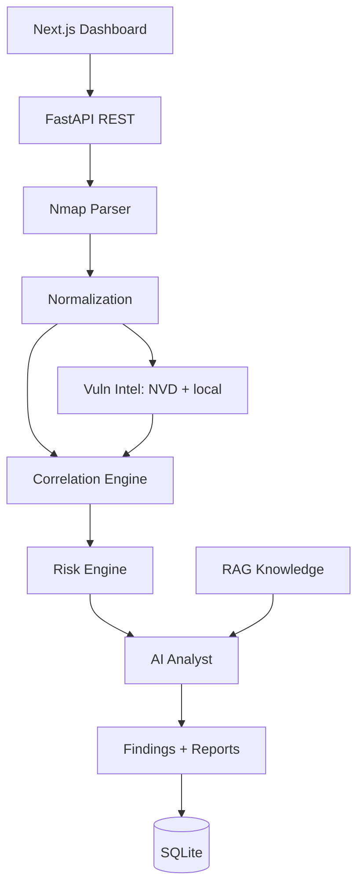

# Sentinel-AI

Sentinel-AI is an AI-powered cybersecurity analysis and vulnerability intelligence platform. It ingests raw security evidence (Nmap XML), normalizes it into typed assets/services, correlates related evidence, scores risk deterministically, enriches with vulnerability intelligence (NVD + local dataset), and produces structured AI analysis, remediation guidance, and reports.

## Features

- Nmap XML ingestion with safe parsing (defusedxml, size limits, XXE protection)
- Asset & service normalization and deduplication
- Rule-based correlation engine (extensible `Rule` interface)
- Deterministic risk engine (0–100 with confidence/exposure factors)
- Vulnerability intelligence: local CVE dataset + NVD API with graceful offline fallback
- AI security analyst: OpenAI/Ollama with validated structured output and deterministic local fallback
- Lightweight RAG over bundled security knowledge documents
- Next.js dashboard: overview, assets, findings, finding detail, scan upload, reports
- Docker Compose deployment with healthchecks and CORS configured from the environment

## Architecture



Raw Security Evidence → Normalization → Asset & Service Identification → Evidence Correlation → Vulnerability Intelligence → Risk Scoring → AI Security Analysis → Prioritized Findings → Remediation → Security Report

## Quick Start (Docker)

```bash
cp .env.example .env
docker compose up --build
```

- Backend API: http://localhost:8000 (docs at `/docs`)
- Frontend: http://localhost:3000

## Local Development

Backend:

```bash
cd Backend
python -m venv .venv && .venv\Scripts\activate
pip install -r requirements.txt
uvicorn app.main:app --reload --port 8000
```

Frontend:

```bash
cd frontend
npm install
npm run dev
```

## Environment Variables

See `.env.example`. Keys:

| Variable | Purpose |
| --- | --- |
| `SENTINEL_DATABASE_URL` | SQLAlchemy URL (default SQLite) |
| `SENTINEL_MAX_UPLOAD_BYTES` | Upload size limit (default 10 MB) |
| `SENTINEL_NVD_ENABLED` / `SENTINEL_NVD_API_KEY` | Vulnerability lookup |
| `SENTINEL_OPENAI_API_KEY` / `SENTINEL_ANTHROPIC_API_KEY` | LLM provider keys |
| `SENTINEL_OLLAMA_BASE_URL` | Local LLM fallback |
| `SENTINEL_CORS_ORIGINS` | Allowed browser origins (JSON list, default localhost:3000) |
| `NEXT_PUBLIC_API_URL` / `API_INTERNAL_URL` | Frontend → backend URLs |

## Usage

1. Open http://localhost:3000/scan
2. Upload an Nmap XML file
3. The system parses, normalizes, correlates, scores, and runs AI analysis
4. Inspect assets, findings, and generate a report

Example:

```bash
curl -F "file=@scan.xml" http://localhost:8000/api/v1/evidence/nmap
curl -X POST http://localhost:8000/api/v1/analyze -H "Content-Type: application/json" -d '{"scan_id": "..."}'
curl http://localhost:8000/api/v1/findings
```

## AI Analysis

The AI analyst receives **structured** evidence (assets, findings, risk scores) — not raw text — retrieves relevant security knowledge via RAG, and returns a validated schema:

```json
{
  "summary": "...",
  "risk_assessment": "...",
  "priority_findings": [],
  "attack_paths": [],
  "recommendations": [],
  "missing_information": []
}
```

If no LLM provider is configured, a deterministic fallback analysis with the same schema is returned, so the pipeline always works offline.

## Testing

```bash
cd Backend
pip install -r requirements-dev.txt   # runtime deps + ruff, pytest-cov
pytest --cov=app --cov-report=term-missing
ruff check app tests                   # lint
```

Frontend: `npm run build` (typecheck) and `npm run lint`.

GitHub Actions runs both suites on every push and pull request
(see [`.github/workflows/ci.yml`](.github/workflows/ci.yml)).

## Documentation

- `ARCHITECTURE.md` — system design and rationale
- `API.md` — REST API reference
- `DEVELOPMENT.md` — developer guide
