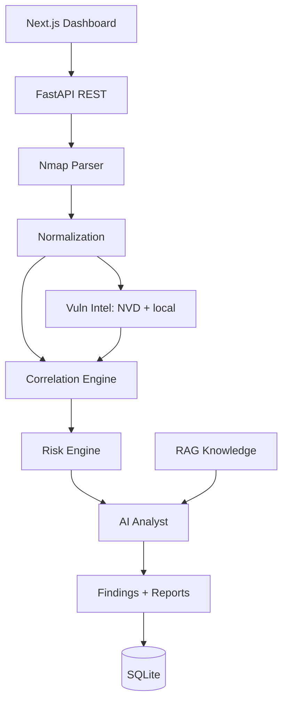

# Sentinel-AI

Sentinel-AI is an AI-powered cybersecurity analysis and vulnerability intelligence platform. It ingests raw security evidence (Nmap XML), normalizes it into typed assets/services, correlates related evidence, scores risk deterministically, enriches with vulnerability intelligence (NVD + local dataset), and produces structured AI analysis, remediation guidance, and reports.

## Features

- Nmap XML ingestion with safe parsing (defusedxml, size limits, XXE protection)
- Asset & service normalization and deduplication
- Rule-based correlation engine (extensible `Rule` interface)
- Deterministic risk engine (0–100 with confidence/exposure factors)
- Finding triage: acknowledge and resolve findings with notes, surviving re-analysis
- Vulnerability intelligence: local CVE dataset + NVD API with graceful offline fallback
- AI security analyst: OpenRouter free models → OpenAI → local Ollama, with validated structured output and deterministic local fallback
- Lightweight RAG over bundled security knowledge documents
- Next.js dashboard: overview, assets, asset detail (services, findings, scan history), scan detail (evidence, AI analysis, findings), scans list, findings, finding detail, scan upload, reports
- Docker Compose deployment with healthchecks and CORS configured from the environment

## Architecture



Raw Security Evidence → Normalization → Asset & Service Identification → Evidence Correlation → Vulnerability Intelligence → Risk Scoring → AI Security Analysis → Prioritized Findings → Remediation → Security Report

## Quick Start (Docker)

```bash
cp .env.example .env
docker compose up --build
```

- Backend API: http://localhost:8000 (docs at `/docs`)
- Frontend: http://localhost:3000

The stack runs without any LLM key by falling back to deterministic analysis.
To enable a hosted model, set `SENTINEL_OPENROUTER_API_KEY` (free tier) or
`SENTINEL_OPENAI_API_KEY` in `.env`. A host-installed Ollama is reachable from
the backend container at `http://host.docker.internal:11434`.

## Local Development

Backend:

```bash
cd Backend
python -m venv .venv && .venv\Scripts\activate
pip install -r requirements.txt
uvicorn app.main:app --reload --port 8000
```

Frontend:

```bash
cd frontend
npm install
npm run dev
```

## Security Notes

This is a demo-grade MVP with **no authentication**. Run it on a trusted
network and do not publish the API port to the internet. Uploads are size-limited
and parsed with XXE protections, and CORS is restricted via
`SENTINEL_CORS_ORIGINS`.

## Environment Variables

See `.env.example`. Keys:

| Variable | Purpose |
| --- | --- |
| `SENTINEL_DATABASE_URL` | SQLAlchemy URL (default SQLite) |
| `SENTINEL_MAX_UPLOAD_BYTES` | Upload size limit (default 10 MB) |
| `SENTINEL_NVD_ENABLED` / `SENTINEL_NVD_API_KEY` | Vulnerability lookup |
| `SENTINEL_NVD_CACHE_TTL_SECONDS` / `SENTINEL_NVD_MIN_INTERVAL_SECONDS` | NVD response cache and request spacing (defaults 900s / 6s) |
| `SENTINEL_LLM_PROVIDER` | `auto`, `openrouter`, `openai`, `ollama`, or `none` |
| `SENTINEL_OPENROUTER_API_KEY` / `SENTINEL_OPENROUTER_MODEL` | Free-first hosted provider (default `meta-llama/llama-3.3-70b-instruct:free`) |
| `SENTINEL_OPENAI_API_KEY` / `SENTINEL_OPENAI_MODEL` | OpenAI fallback |
| `SENTINEL_OLLAMA_BASE_URL` / `SENTINEL_OLLAMA_MODEL` | Local LLM fallback |
| `SENTINEL_CORS_ORIGINS` | Allowed browser origins (JSON list, default localhost:3000) |
| `NEXT_PUBLIC_API_URL` / `API_INTERNAL_URL` | Frontend → backend URLs (`NEXT_PUBLIC_API_URL` is baked in at build time) |

The backend loads the repo-root `.env` first, then `Backend/.env` (which wins if
both define the same variable).

## Usage

1. Open http://localhost:3000/scan
2. Upload an Nmap XML file
3. The system parses, normalizes, correlates, scores, and runs AI analysis
4. Inspect assets, findings, and generate a report (a report requires a scan that has completed analysis)

Example:

```bash
curl -F "file=@scan.xml" http://localhost:8000/api/v1/evidence/nmap
curl -X POST http://localhost:8000/api/v1/analyze -H "Content-Type: application/json" -d '{"scan_id": "..."}'
curl http://localhost:8000/api/v1/findings
```

## AI Analysis

The AI analyst receives **structured** evidence (assets, findings, risk scores) — not raw text — retrieves relevant security knowledge via RAG, and returns a validated schema:

```json
{
  "summary": "...",
  "risk_assessment": "...",
  "priority_findings": [],
  "attack_paths": [],
  "recommendations": [],
  "missing_information": []
}
```

In `auto` mode the analyst tries OpenRouter free models first, then OpenAI, then
Ollama, skipping any provider without a key. Set `SENTINEL_LLM_PROVIDER` to
force a provider first; `none` disables LLM calls entirely. If no provider is
configured or every call fails, a deterministic fallback analysis with the same
schema is returned, so the pipeline always works offline.

## Testing

```bash
cd Backend
pip install -r requirements-dev.txt   # runtime deps + ruff, pytest-cov
pytest --cov=app --cov-report=term-missing
ruff check app tests                   # lint
```

Frontend: `npm test` (Vitest), `npm run lint`, and `npm run build` (typecheck).

GitHub Actions runs both suites on every push and pull request
(see [`.github/workflows/ci.yml`](.github/workflows/ci.yml)).

## Documentation

- `ARCHITECTURE.md` — system design and rationale
- `API.md` — REST API reference
- `DEVELOPMENT.md` — developer guide
